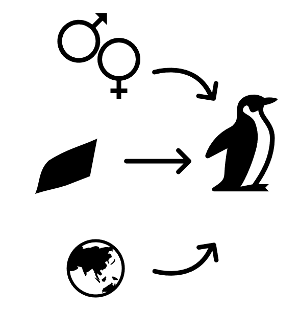
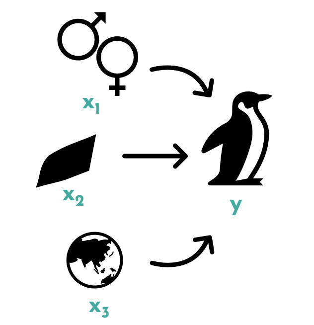
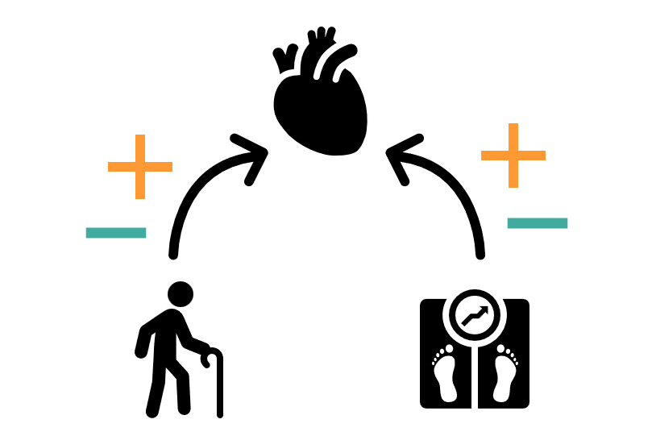
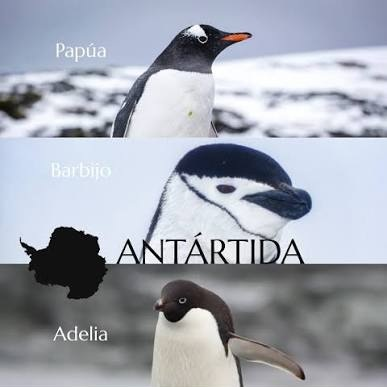

```{r setup, include=FALSE}
options(htmltools.dir.version = FALSE, width = 200)
#knitr::include_graphics()
knitr::opts_chunk$set(
  cache = TRUE,
  echo = TRUE,
  message = FALSE, 
  warning = FALSE,
  hiline = TRUE,
  fig.retina = 5,
  fig.align = "center",
  comment = ""
)

library(ggplot2)
library(readr)
library(knitr)
```

```{r xaringan-themer, include=FALSE, warning=FALSE}
library(xaringanthemer)
style_mono_accent(
  base_color = "#1c5253", link_color =  "#DE1144", code_inline_color = "#DE1144",
  header_font_google = google_font("Josefin Sans"),
  text_font_google   = google_font("Montserrat", "400", "400i"),
  code_font_google   = google_font("Roboto Mono"),
    
)
```


```{r xaringanExtra-clipboard, echo=FALSE}
library(xaringanExtra)
htmltools::tagList(
  xaringanExtra::use_clipboard(
    button_text = "<i class=\"fa fa-clipboard\"></i>",
    success_text = "<i class=\"fa fa-check\" style=\"color: #90BE6D\"></i>",
  ),
  rmarkdown::html_dependency_font_awesome()
)
```


class: title-slide, animated, fadeIn

.left-top[
# Regresión

]

.left-bottom[
.authors[
**Bioestadística**
<br><br><br><br>

Marta Coronado ([marta.coronado@uab.cat](mailto:marta.coronado@uab.cat))  
]

.footer-info[
**Grado en Genética | Curso 2026/2027**
]
]

.right-panel[]


<style>
.title-slide {
  background-image: none;
}

/* Contenedor teal superior (solo título) */
.title-slide .left-top {
  position: absolute;
  top: 0; left: 0;
  width: 60%;
  height: 62%;
  background-color: #163a3a;
  color: white;
  padding: 50px 45px 30px 65px;
  margin: 0;
  display: flex;
  flex-direction: column;   /* ← esto faltaba */
  align-items: flex-start;  /* ← con column, flex-end alinearía a la derecha; usa flex-start para pegar a la izquierda */
  justify-content: flex-end;
  box-sizing: border-box;
}

/* Contenedor blanco inferior (autores, fecha) */
.title-slide .left-bottom {
  position: absolute;
  bottom: 0; left: 0;
  width: 60%;
  height: 38%;
  background-color: white;
  color: #222;
  display: flex;
  flex-direction: column;
  justify-content: center;
  box-sizing: border-box;
  padding: 20px 45px 30px 65px;
  margin: 0;
}

.title-slide .right-panel {
  position: absolute;
  top: 0; right: 0; bottom: 0;
  width: 41%;
  background-color: white;
  background-image: url('img/1.png');
  background-size: contain;
  background-repeat: no-repeat;
  background-position: center;
  padding: 40px;
  box-sizing: border-box;
}

.title-slide h1 {
  font-size: 1.9em;
  line-height: 1.25;
  margin: 0;
  font-weight: 400;
}

.title-slide .subtitle {
  display: block;   /* ← esto es la clave: sin esto, margin-top se ignora */
  font-size: 2em;
  font-weight: bold;
  color: #7ac142;
  margin-top: -35px;
  margin-bottom: 15px;
}

.title-slide .authors {
  font-size: 0.95em;
  line-height: 1.6;
  margin-bottom: 12px;
}

.title-slide .authors a {
  color: #e8846b;
  text-decoration: none;
}

.title-slide .footer-info {
  font-size: 0.9em;
  color: #444;
}

.remark-slide-content h2,
.remark-slide-content h3,
.remark-slide-content h4,
.remark-slide-content h5 {
  margin-top: 1em;
  margin-bottom: 0.6em;
}

.remark-slide-content p,
.remark-slide-content ul,
.remark-slide-content ol {
  margin-top: 0.2em;
  margin-bottom: 0.2em;
}

.remark-slide-content li {
  margin-bottom: 0.1em;
}

.practica::before {
  content: "\f303";
  font-family: "Font Awesome 6 Free";
  font-weight: 900;
  position: absolute;
  top: 15px;
  right: 15px;
  font-size: 1.3em;
  color: #1c5253;
}

.R::before {
  content: "\f4f7";
  font-family: "Font Awesome 6 Brands";
  font-weight: 400;
  position: absolute;
  top: 15px;
  right: 15px;
  font-size: 1.3em;
  color: #1c5253;
}
.hueco {
  border: 3px dashed #1c5253;
  border-radius: 14px;
  background-color: #eef4f4;
  color: #1c5253;
  display: flex;
  flex-direction: column;
  align-items: center;
  justify-content: center;
  text-align: center;
  font-size: 0.85em;
  font-style: italic;
  padding: 15px;
  margin: 10px auto;
  box-sizing: border-box;
}

.texto-peq { font-size: 75%; }
.texto-peq .remark-code { font-size: 100%; }
.codigo-mini .remark-code { font-size: 62%; }
</style>

```{r datos, include=FALSE}
library(dplyr)
library(tidyr)
library(patchwork)

# Pingüinos de Palmer (incluidos en R >= 4.5)
pinguinos <- na.omit(penguins[, c("species", "sex", "flipper_len", "body_mass")])

# Submuestra pequeña para dibujar residuos
set.seed(3)
muestra <- pinguinos[sample(nrow(pinguinos), 12), ]

# Modelo de regresión simple
modelo <- lm(body_mass ~ flipper_len, data = pinguinos)
a <- coef(modelo)[1]
b <- coef(modelo)[2]

# Datos simulados de presión arterial
set.seed(42)
n <- 100
edad       <- round(runif(n, 30, 75))
peso       <- round(rnorm(n, 78, 14))
colesterol <- round(rnorm(n, 200, 35))
presion    <- round(55 + 0.4 * edad + 0.25 * peso + 0.2 * colesterol + rnorm(n, 0, 9))
talla      <- rnorm(n, 1.70, 0.025)
imc        <- round(peso / talla^2, 1)
datos_pa   <- data.frame(presion, edad, peso, colesterol)
modelo_pa  <- lm(presion ~ edad + peso + colesterol, data = datos_pa)

tema <- theme_classic(base_size = 16)
```

---
class: animated, fadeIn
# Outline

#### **Regresión**

- ¿Qué es un análisis de regresión? Objetivos y tipos
- Regresión lineal simple: la recta, el cálculo y la predicción
- Supuestos de la regresión
- Contraste de hipótesis y $R^2$
- Regresión lineal múltiple: coeficientes, multicolinealidad e interpretación
- Variables *dummy*
- ANOVA y regresión: el mismo modelo

---
class: animated, fadeIn

## ¿Qué es un análisis de regresión?

> Un método para **modelar la relación** entre variables. Permite **inferir** o **predecir** una variable a partir de una o más variables.

--

.pull-left[
<br>
¿Qué influye en la **masa corporal** de un pingüino?

- La longitud de su aleta
- La especie
- El sexo

Si estas variables influyen, podemos **predecir** la masa de un pingüino conociendo solo esa información.
]

.pull-right[

]

---
class: animated, fadeIn

## Variable dependiente e independientes

.pull-left[
- **Variable dependiente** ( $y$ ): la que queremos inferir o predecir
  - También: variable **respuesta** o *outcome*
  - Ej.: masa corporal

<br>

- **Variables independientes** ( $x_1, x_2, \dots$ ): las que usamos para predecir
  - También: variables **predictoras** o **explicativas**
  - Ej.: longitud de la aleta, especie, sexo
]

.pull-right[

]

---
class: animated, fadeIn

## Dos objetivos de la regresión

.pull-left[
#### 1. Medir la **influencia** de una o más variables sobre otra

*Orientado a la investigación*

¿Qué factores influyen en la **presión arterial**? ¿La edad, el peso, el colesterol? ¿Su efecto es positivo o negativo?


]

.pull-right[
#### 2. **Predecir** una variable a partir de otras

*Orientado a la aplicación*

¿Qué **edad** tiene un pez a partir de su longitud? ¿Cuántos **días** estará un paciente ingresado?

<br><br>

]

---
class: animated, fadeIn

## Tipos de regresión

.texto-peq[
| Tipo | Variable dependiente | Variables independientes | Ejemplo biológico |
|:--|:--|:--|:--|
| **Lineal simple** | Cuantitativa | Una | Masa corporal según la longitud de la aleta |
| **Lineal múltiple** | Cuantitativa | Dos o más | Presión arterial según edad, peso y colesterol |
| **Logística** | Categórica (p. ej. sí/no) | Una o más | Riesgo de enfermedad según la dosis de exposición |
]

<br>

.pull-left[
```{r tipos-lineal, echo = FALSE, fig.width = 6, fig.height = 2.8}
tema_tipos <- theme_classic(base_size = 13) +
  theme(plot.title = element_text(face = "bold", hjust = 0.5),
        plot.subtitle = element_text(hjust = 0.5, family = "mono", size = 10),
        axis.text = element_blank(), axis.ticks = element_blank())

# Simple: una recta
p_simple <- ggplot(pinguinos, aes(x = flipper_len, y = body_mass)) +
  geom_point(colour = "#1c5253", alpha = 0.35, size = 1.2) +
  geom_smooth(method = "lm", se = FALSE, colour = "#DE1144", linewidth = 1.2) +
  labs(title = "Simple", subtitle = "masa ~ aleta", x = "Aleta (mm)", y = "Masa (g)") +
  tema_tipos

# Múltiple: aleta + sexo (una recta por sexo)
modelo_tipos <- lm(body_mass ~ flipper_len + sex, data = pinguinos)

p_multiple <- ggplot(pinguinos, aes(x = flipper_len, y = body_mass, colour = sex)) +
  geom_point(alpha = 0.35, size = 1.2) +
  geom_line(aes(y = predict(modelo_tipos)), linewidth = 1.2) +
  scale_colour_manual(values = c(female = "#E69F00", male = "#1c5253"),
                      labels = c("Hembra", "Macho"), name = "Sexo") +
  labs(title = "Múltiple", subtitle = "masa ~ aleta + sexo", x = "Aleta (mm)", y = NULL) +
  tema_tipos +
  theme(legend.position = c(0.22, 0.85), legend.background = element_blank(),
        legend.title = element_text(size = 10, face = "bold"),
        legend.key.height = unit(0.4, "cm"))

p_simple + p_multiple
```
]

.pull-right[
```{r tipos-logistica, echo = FALSE, fig.width = 4.5, fig.height = 2.8}
# Logística: probabilidad de ser macho según la masa (pingüinos Adelia)
adelia <- subset(pinguinos, species == "Adelie")
adelia$macho <- as.numeric(adelia$sex == "male")

ggplot(adelia, aes(x = body_mass, y = macho)) +
  geom_jitter(height = 0.03, width = 0, colour = "#1c5253", alpha = 0.4, size = 1.4) +
  geom_smooth(method = "glm", method.args = list(family = binomial),
              se = FALSE, colour = "#DE1144", linewidth = 1.2) +
  scale_y_continuous(breaks = c(0, 0.5, 1), labels = c("0 (hembra)", "0.5", "1 (macho)")) +
  labs(title = "Logística", subtitle = "sexo ~ masa", x = "Masa (g)", y = "P(macho)") +
  tema_tipos +
  theme(axis.text.y = element_text())
```
]

---
class: animated, fadeIn

## Tipos de variables en la regresión

- **Variable dependiente**
  - Regresión **lineal** (simple y múltiple): cuantitativa (masa, presión, expresión génica…)
  - Regresión **logística**: categórica (enfermo/sano, presencia/ausencia de una especie…). Si tiene dos categorías, hablamos de regresión logística **binaria**

--

- **Variables independientes**: pueden ser **nominales**, **ordinales** o **cuantitativas**

--

  - Una variable categórica entra en el modelo codificada con **dos niveles**: sexo → hembra = 0, macho = 1

  - ¿Y si tiene más de dos categorías (p. ej. tres especies)? → **Variables *dummy*** (lo veremos al final del tema)

---
layout: false
class: left, bottom, inverse, animated, bounceInDown

## Regresión lineal simple

---
class: animated, fadeIn

## Regresión lineal simple

> Método para entender la relación entre **dos variables**: permite inferir o predecir una variable a partir de la otra.

.pull-left[
**Ejemplo**: ¿podemos predecir la **masa corporal** de un pingüino a partir de la **longitud de su aleta**?

Datos: `penguins` con `r nrow(pinguinos)` pingüinos de la Antártida.

```{r, echo = F}
kable(head(muestra[, c("flipper_len", "body_mass")], 6),
      col.names = c("Aleta (mm)", "Masa (g)"), row.names = FALSE)
```
]

.pull-right[

]

---
class: animated, fadeIn

## La ecuación de la recta

$$\hat{y} = a + b\,x$$

- $\hat{y}$: valor **predicho** de la variable dependiente (masa corporal)
- $x$: variable independiente (longitud de la aleta)
- $a$: **ordenada en el origen** (*intercept*): dónde corta la recta el eje $y$
- $b$: **pendiente** (*slope*): cuánto cambia $y$ cuando $x$ aumenta 1 unidad

> Objetivo: usar los datos para estimar $a$ y $b$

.footnote[También se escribe *y* = β<sub>0</sub> + β<sub>1</sub>*x* + ε, como vimos en el tema de correlación.]

---
class: animated, fadeIn

## Visualizamos los datos

```{r, echo = F, fig.width = 10, fig.height = 5.2}
ggplot(muestra, aes(x = flipper_len, y = body_mass)) +
  geom_point(size = 4, colour = "#1c5253") +
  labs(x = "Longitud de la aleta (mm)", y = "Masa corporal (g)") +
  tema
```

---
class: animated, fadeIn

## Trazamos una recta…

```{r, echo = F, fig.width = 10, fig.height = 5.2}
a_mala <- -2000; b_mala <- 30
ggplot(muestra, aes(x = flipper_len, y = body_mass)) +
  geom_abline(intercept = a_mala, slope = b_mala, colour = "grey50", linewidth = 1.2) +
  geom_point(size = 4, colour = "#1c5253") +
  labs(x = "Longitud de la aleta (mm)", y = "Masa corporal (g)") +
  tema
```

---
class: animated, fadeIn

## … y medimos el error de cada punto

```{r, echo = F, fig.width = 10, fig.height = 5.2}
muestra$pred_mala <- a_mala + b_mala * muestra$flipper_len
ss_mala <- sum((muestra$body_mass - muestra$pred_mala)^2)
ggplot(muestra, aes(x = flipper_len, y = body_mass)) +
  geom_segment(aes(xend = flipper_len, yend = pred_mala), colour = "#DE1144", linewidth = 1) +
  geom_abline(intercept = a_mala, slope = b_mala, colour = "grey50", linewidth = 1.2) +
  geom_point(size = 4, colour = "#1c5253") +
  labs(x = "Longitud de la aleta (mm)", y = "Masa corporal (g)",
       subtitle = paste0("Suma de residuos al cuadrado = ", format(round(ss_mala), big.mark = "."))) +
  tema
```

Cada línea roja es un **residuo**: la distancia entre el valor observado $y$ y el predicho $\hat{y}$.

---
class: animated, fadeIn

## La mejor recta: mínimos cuadrados

```{r, echo = F, fig.width = 10, fig.height = 5.2}
m_muestra <- lm(body_mass ~ flipper_len, data = muestra)
muestra$pred <- fitted(m_muestra)
ss_buena <- sum(residuals(m_muestra)^2)
ggplot(muestra, aes(x = flipper_len, y = body_mass)) +
  geom_segment(aes(xend = flipper_len, yend = pred), colour = "#DE1144", linewidth = 1) +
  geom_smooth(method = "lm", se = FALSE, colour = "#1c5253", linewidth = 1.2) +
  geom_point(size = 4, colour = "#1c5253") +
  labs(x = "Longitud de la aleta (mm)", y = "Masa corporal (g)",
       subtitle = paste0("Suma de residuos al cuadrado = ", format(round(ss_buena), big.mark = "."))) +
  tema
```

> La recta de regresión es la que hace **mínima** la suma de los residuos al cuadrado

---
class: animated, fadeIn

## Interpretar $a$ y $b$

```{r, echo = F, fig.width = 10, fig.height = 4.6}
x0 <- 190
ggplot(pinguinos, aes(x = flipper_len, y = body_mass)) +
  geom_point(size = 2, colour = "grey60") +
  geom_abline(intercept = a, slope = b, colour = "#1c5253", linewidth = 1.2) +
  annotate("segment", x = x0, xend = x0 + 20, y = a + b * x0, yend = a + b * x0,
           colour = "#DE1144", linewidth = 1.2) +
  annotate("segment", x = x0 + 20, xend = x0 + 20, y = a + b * x0, yend = a + b * (x0 + 20),
           colour = "#DE1144", linewidth = 1.2) +
  annotate("label", x = x0 + 10, y = a + b * x0 - 250, label = "+20 mm", colour = "#DE1144", size = 6) +
  annotate("label", x = x0 + 21, y = a + b * (x0 + 10), label = paste0("+", round(20 * b), " g"),
           colour = "#DE1144", size = 6, hjust = 0) +
  labs(x = "Longitud de la aleta (mm)", y = "Masa corporal (g)") +
  tema
```

- **Pendiente** $b$ = `r round(b, 1)`: por cada mm más de aleta, la masa aumenta en promedio `r round(b, 1)` g
- **Ordenada** $a$ = `r round(a)`: la masa de un pingüino con aleta de 0 mm. ¡No tiene sentido biológico!

---
class: animated, fadeIn

## Todo modelo es una simplificación

.pull-left[
<br>
- La recta solo describe bien los datos **dentro del rango observado** (aletas de `r min(pinguinos$flipper_len)` a `r max(pinguinos$flipper_len)` mm)

- Fuera de ese rango, **extrapolar** puede dar resultados absurdos, como una masa negativa

<br>

> *All models are wrong, but some are useful* (George Box)
]

.pull-right[
```{r extrapolacion, echo = FALSE, fig.width = 6, fig.height = 5.2}
rango <- range(pinguinos$flipper_len)
x_ext <- 100                 # pingüino hipotético con una aleta de 100 mm
y_ext <- a + b * x_ext

ggplot(pinguinos, aes(x = flipper_len, y = body_mass)) +
  annotate("rect", xmin = rango[1], xmax = rango[2], ymin = -Inf, ymax = Inf,
           fill = "#1c5253", alpha = 0.08) +
  geom_hline(yintercept = 0, colour = "grey40") +
  geom_point(size = 1.5, colour = "grey60") +
  # Recta extrapolada (fuera del rango) y recta ajustada (dentro del rango)
  annotate("segment", x = 0, xend = rango[1], y = a, yend = a + b * rango[1],
           colour = "#1c5253", linewidth = 1.2, linetype = "dashed") +
  annotate("segment", x = rango[1], xend = rango[2], y = a + b * rango[1], yend = a + b * rango[2],
           colour = "#1c5253", linewidth = 1.2) +
  # Predicciones absurdas
  annotate("point", x = c(0, x_ext), y = c(a, y_ext), colour = "#DE1144", size = 4) +
  annotate("label", x = x_ext + 8, y = y_ext, hjust = 0, colour = "#DE1144", size = 4.5,
           label = paste0("Aleta de ", x_ext, " mm\n", format(round(y_ext), big.mark = ".", decimal.mark = ","), " g")) +
  annotate("label", x = 8, y = a, hjust = 0, colour = "#DE1144", size = 4.5,
           label = paste0("Aleta de 0 mm: ", format(round(a), big.mark = ".", decimal.mark = ","), " g")) +
  annotate("text", x = mean(rango), y = max(pinguinos$body_mass) + 600,
           label = "Rango observado", colour = "#1c5253", size = 4.5) +
  expand_limits(x = 0) +
  labs(x = "Longitud de la aleta (mm)", y = "Masa corporal (g)") +
  tema
```
]

---
class: animated, fadeIn

## Calcular $a$ y $b$

La pendiente se obtiene a partir de la **correlación** y las **desviaciones típicas**:

$$b = r \cdot \frac{s_y}{s_x}$$

--

Y la recta siempre pasa por el punto de medias $(\bar{x}, \bar{y})$, así que:

$$a = \bar{y} - b\,\bar{x}$$

--

```{r}
r <- cor(pinguinos$flipper_len, pinguinos$body_mass)
b <- r * sd(pinguinos$body_mass) / sd(pinguinos$flipper_len)
a <- mean(pinguinos$body_mass) - b * mean(pinguinos$flipper_len)
c(a = a, b = b)
```

---
class: animated, fadeIn

## Regresión lineal simple en `R`

```{r}
modelo <- lm(body_mass ~ flipper_len, data = pinguinos)
modelo
```

--

- `lm()` = *linear model*, la misma función que usamos en el ANOVA
- Se lee: «masa corporal **en función de** la longitud de la aleta»

$$\widehat{\text{masa}} = `r round(coef(modelo)[1], 1)` + `r round(coef(modelo)[2], 2)` \cdot \text{aleta}$$

---
class: animated, fadeIn

## Predecir con el modelo

¿Cuál es la masa esperada de un pingüino con una aleta de 200 mm?

Sustituimos en la ecuación de la recta:

$$\widehat{\text{masa}} = a + b \cdot \text{aleta} = `r round(a, 1)` + `r round(b, 2)` \cdot 200 = `r round(round(a, 1) + round(b, 2) * 200, 1)` \text{ g}$$

```{r}
-5872.1 + 50.15 * 200
```

--

O directamente con `predict()`:

```{r}
predict(modelo, newdata = data.frame(flipper_len = 200))
```

--

> La pequeña diferencia con el cálculo a mano se debe al **redondeo** de $a$ y $b$.

> Con `interval = "prediction"`, `predict()` también da un intervalo de valores probables para un pingüino nuevo.

---
layout: false
class: left, bottom, inverse, animated, bounceInDown

## Supuestos de la regresión

---
class: animated, fadeIn

## Supuestos de la regresión lineal

1. **Relación lineal** entre $x$ e $y$
2. **Independencia** de los errores
3. **Homocedasticidad**: varianza constante de los errores
4. **Normalidad** de los errores

> Como en el ANOVA, los supuestos 2 a 4 se comprueban sobre los **residuos**

```{r supuestos-resumen, echo = F, fig.width = 12, fig.height = 2.9}
set.seed(21)
sup <- data.frame(x = runif(80, 0, 10), orden = 1:80, residuo = rnorm(80))
sup$y <- 2 + 0.8 * sup$x + rnorm(80, 0, 1)
sup$pred <- seq(0, 10, length.out = 80)
sup$res_pred <- runif(80, -1, 1)   # banda de anchura constante

tema_sup <- theme_classic(base_size = 15) +
  theme(plot.title = element_text(face = "bold", size = 14, hjust = 0.5),
        axis.text = element_blank(), axis.ticks = element_blank())

s1 <- ggplot(sup, aes(x, y)) +
  geom_point(colour = "#1c5253", size = 1.5) +
  geom_smooth(method = "lm", se = FALSE, colour = "#DE1144") +
  labs(title = "1. Lineal", x = "x", y = "y") + tema_sup
s2 <- ggplot(sup, aes(orden, residuo)) +
  geom_hline(yintercept = 0, linetype = "dashed", colour = "grey50") +
  geom_line(colour = "grey75") + geom_point(colour = "#1c5253", size = 1.5) +
  labs(title = "2. Independencia", x = "Orden", y = "Residuo") + tema_sup
s3 <- ggplot(sup, aes(pred, res_pred)) +
  geom_hline(yintercept = 0, linetype = "dashed", colour = "grey50") +
  geom_hline(yintercept = c(-1.1, 1.1), colour = "#DE1144", linewidth = 1) +
  geom_point(colour = "#1c5253", size = 1.5) +
  labs(title = "3. Homocedasticidad", x = "Predichos", y = "Residuo") + tema_sup
s4 <- ggplot(sup, aes(residuo)) +
  geom_histogram(aes(y = after_stat(density)), bins = 12, fill = "#1c5253", colour = "white") +
  stat_function(fun = dnorm, colour = "#DE1144", linewidth = 1) +
  labs(title = "4. Normalidad", x = "Residuo", y = NULL) + tema_sup

s1 + s2 + s3 + s4 + plot_layout(nrow = 1)
```

---
class: animated, fadeIn

## 1. Relación lineal

La recta debe representar todos los puntos lo mejor posible. Si la relación **no es lineal**, una recta no puede hacerlo.

```{r, echo = F, fig.width = 12, fig.height = 4.4}
set.seed(7)
lin <- data.frame(x = runif(60, 0, 10))
lin$y <- 2 + 0.8 * lin$x + rnorm(60, 0, 1)
lin$tiempo <- runif(60, 0, 8)
lin$od <- 0.05 * exp(0.5 * lin$tiempo) * exp(rnorm(60, 0, 0.12))
g1 <- ggplot(lin, aes(x, y)) +
  geom_point(size = 2.5, colour = "#1c5253") +
  geom_smooth(method = "lm", se = FALSE, colour = "#DE1144") +
  labs(title = "Lineal ✔", x = "Temperatura (°C)", y = "Tasa metabólica") + tema
g2 <- ggplot(lin, aes(tiempo, od)) +
  geom_point(size = 2.5, colour = "#1c5253") +
  geom_smooth(method = "lm", se = FALSE, colour = "#DE1144") +
  labs(title = "No lineal ✘", x = "Tiempo (h)", y = "Densidad óptica (cultivo)") + tema
g1 + g2
```

> El crecimiento bacteriano es **exponencial**: transformar con `log()` lo vuelve lineal

---
class: animated, fadeIn

## 2. Independencia de los errores

El error de un punto no debe influir en el error de otro.

.pull-left[
Se incumple, por ejemplo, con:

- **Medidas repetidas** del mismo individuo
- **Series temporales** (un día influye en el siguiente)
- Individuos **emparentados** o de la misma camada

<br>

> Se garantiza sobre todo con un buen **diseño experimental** (muestreo aleatorio)
]

.pull-right[
```{r, echo = F, fig.width = 6, fig.height = 5.5}
set.seed(11)
ind <- data.frame(orden = 1:60, indep = rnorm(60), dep = cumsum(rnorm(60, 0, 0.5)))
ind <- pivot_longer(ind, -orden, names_to = "tipo", values_to = "residuo")
ind$tipo <- factor(ind$tipo, levels = c("indep", "dep"),
                   labels = c("Independientes ✔", "Dependientes ✘"))
ggplot(ind, aes(orden, residuo)) +
  geom_hline(yintercept = 0, linetype = "dashed", colour = "grey50") +
  geom_line(colour = "grey70") +
  geom_point(colour = "#1c5253", size = 2) +
  facet_wrap(~tipo, ncol = 1) +
  labs(x = "Orden de medida", y = "Residuo") + tema
```
]

---
class: animated, fadeIn

## 3. Homocedasticidad

Si representamos los **residuos** frente a los **valores predichos**, su dispersión debe ser parecida en todo el rango.

```{r, echo = F, fig.width = 12, fig.height = 4.4}
set.seed(5)
h <- data.frame(pred = runif(150, 1, 10))
h$homo   <- rnorm(150, 0, 1)
h$hetero <- rnorm(150, 0, 0.25 * h$pred)
g1 <- ggplot(h, aes(pred, homo)) +
  geom_hline(yintercept = 0, linetype = "dashed", colour = "grey50") +
  geom_hline(yintercept = c(-2, 2), colour = "#DE1144", linewidth = 1) +
  geom_point(colour = "#1c5253", size = 2.2) +
  labs(title = "Varianza constante ✔", x = "Valores predichos", y = "Residuos") + tema
g2 <- ggplot(h, aes(pred, hetero)) +
  geom_hline(yintercept = 0, linetype = "dashed", colour = "grey50") +
  geom_abline(intercept = 0, slope = c(-0.5, 0.5), colour = "#DE1144", linewidth = 1) +
  geom_point(colour = "#1c5253", size = 2.2) +
  labs(title = "Forma de embudo ✘", x = "Valores predichos", y = "Residuos") + tema
g1 + g2
```

> Ej.: en datos de expresión génica, la varianza suele **crecer con la media**

---
class: animated, fadeIn

## 4. Normalidad de los errores

```{r, echo = F, fig.width = 12, fig.height = 4.2}
res <- data.frame(residuo = residuals(modelo))
g1 <- ggplot(res, aes(residuo)) +
  geom_histogram(bins = 25, fill = "#1c5253", colour = "white") +
  labs(title = "Histograma", x = "Residuos", y = "Frecuencia") + tema
g2 <- ggplot(res, aes(sample = residuo)) +
  stat_qq(colour = "#1c5253") + stat_qq_line(colour = "#DE1144") +
  labs(title = "QQ plot", x = "Cuantiles teóricos", y = "Cuantiles observados") + tema
g1 + g2
```

- Se puede comprobar **analíticamente** (Shapiro-Wilk) o **gráficamente** (QQ plot)
- ¡Cuidado con los tests! Con muestras **pequeñas** casi nunca rechazan la normalidad y con muestras **grandes** salen significativos enseguida → hoy se prefiere el **QQ plot**

---
class: animated, fadeIn

## Comprobar los supuestos con nuestros pingüinos

Representamos los **residuos** frente a los **valores predichos** del modelo `masa ~ aleta`:

.pull-left[
.texto-peq[
```{r, fig.width = 6.5, fig.height = 4}
diag <- data.frame(predichos = fitted(modelo),
                   residuos = residuals(modelo))

ggplot(diag, aes(x = predichos, y = residuos)) +
  geom_hline(yintercept = 0, linetype = "dashed") +
  geom_point(colour = "#1c5253", alpha = 0.6) +
  labs(x = "Valores predichos (g)", y = "Residuos (g)") +
  theme_classic(base_size = 16)
```
]
]

.pull-right[
<br><br>

- Sin patrón curvo → **linealidad** ✔

<br>

- Dispersión parecida en todo el rango → **homocedasticidad** ✔

<br>

- Dos grupos de puntos: ¿falta alguna variable en el modelo? → **la especie** (lo veremos en la regresión múltiple)
]

---
layout: false
class: left, bottom, inverse, animated, bounceInDown

## Contraste de hipótesis y R²

---
class: animated, fadeIn

## ¿Es significativa la relación?

El **p-valor** nos dice si la relación entre $x$ e $y$ es real o podría deberse al **azar**.

.pull-left[
- $H_0$: no hay relación → la pendiente es $b = 0$
- $H_A$: hay relación → $b \neq 0$

<br>

- p-valor **< 0.05**: rechazamos $H_0$ → relación **significativa**

- p-valor **≥ 0.05**: los datos podrían haber salido por azar; no hay evidencia de relación
]

.pull-right[
```{r hipotesis-pendiente, echo = F, fig.width = 6.5, fig.height = 4.4}
set.seed(8)
hip <- data.frame(x = runif(40, 0, 10))
hip$y_h0 <- 5 + rnorm(40, 0, 1.5)                  # sin relación
hip$y_ha <- 1.5 + 0.7 * hip$x + rnorm(40, 0, 1.5)  # con relación

tema_hip <- theme_classic(base_size = 15) +
  theme(plot.title = element_text(face = "bold", hjust = 0.5),
        axis.text = element_blank(), axis.ticks = element_blank())

h0 <- ggplot(hip, aes(x, y_h0)) +
  geom_point(colour = "#1c5253", size = 2) +
  geom_hline(yintercept = mean(hip$y_h0), colour = "#DE1144", linewidth = 1.2) +
  labs(title = expression(H[0]*":"~~b == 0), x = "x", y = "y") +
  tema_hip

ha <- ggplot(hip, aes(x, y_ha)) +
  geom_hline(yintercept = mean(hip$y_ha), colour = "grey60", linewidth = 1, linetype = "dashed") +
  geom_point(colour = "#1c5253", size = 2) +
  geom_smooth(method = "lm", se = FALSE, colour = "#DE1144", linewidth = 1.2) +
  labs(title = expression(H[A]*":"~~b != 0), x = "x", y = NULL) +
  tema_hip

h0 + ha
```
]

---
class: animated, fadeIn

## `summary()` del modelo

.pull-left[
.codigo-mini[
```{r}
modelo <- lm(body_mass ~ flipper_len, data = pinguinos)
summary(modelo)
```
]
]

.pull-right[
.texto-peq[
- `Estimate`: los coeficientes: $a$ = `(Intercept)` y $b$ = `flipper_len`
- `Pr(>|t|)` de `flipper_len`: p-valor del test $H_0: b = 0$ → p < 2·10<sup>-16</sup>, la relación es significativa
- `Multiple R-squared` = `r round(summary(modelo)$r.squared, 3)`: la longitud de la aleta explica el **`r round(100 * summary(modelo)$r.squared)`%** de la variabilidad de la masa corporal
- `Residual standard error` = `r round(summary(modelo)$sigma)` g: en promedio, las predicciones se desvían unos `r round(summary(modelo)$sigma)` g de la masa real

<br>

> En la regresión simple, $R^2 = r^2$: `r round(cor(pinguinos$flipper_len, pinguinos$body_mass), 3)`² = `r round(summary(modelo)$r.squared, 3)`
]
]

---
layout: false
class: left, bottom, inverse, animated, bounceInDown

## Regresión lineal múltiple

---
class: animated, fadeIn

## Regresión lineal múltiple

> Modela la relación entre **una** variable dependiente y **dos o más** variables independientes.

.pull-left[
**Ejemplo**: ¿influyen la **edad**, el **peso** y el **colesterol** en la **presión arterial** sistólica?

- Variable dependiente: presión arterial (mmHg)
- Variables independientes: edad (años), peso (kg) y colesterol (mg/dL)

```{r, echo = F}
kable(head(datos_pa, 5), col.names = c("Presión", "Edad", "Peso", "Colesterol"))
```
]

.pull-right[

]

---
class: animated, fadeIn

## La ecuación de la regresión múltiple

.pull-left[
**Simple**: una variable independiente

$$\hat{y} = a + b\,x$$
]

.pull-right[
**Múltiple**: $k$ variables independientes

$$\hat{y} = a + b_1 x_1 + b_2 x_2 + \dots + b_k x_k$$
]

<br><br>

- $a$: valor de $\hat{y}$ cuando **todas** las $x$ valen 0
- $b_i$: cambio en $\hat{y}$ cuando $x_i$ aumenta 1 unidad **y las demás variables se mantienen constantes**
- $\hat{y}$ es el valor **predicho** por el modelo; $y$, el valor **observado**. Su diferencia es el **residuo**

---
class: animated, fadeIn

## Supuestos de la regresión múltiple

Los cuatro de la regresión simple…

1. **Relación lineal** → un gráfico de dispersión para cada variable
2. **Independencia** de los errores
3. **Homocedasticidad** → residuos frente a valores predichos
4. **Normalidad** de los errores → QQ plot

--

… y uno nuevo:

**5. No multicolinealidad**: las variables independientes no deben estar muy correlacionadas entre sí

---
class: animated, fadeIn

## Primero, visualizamos cada variable por separado

```{r, echo = F, fig.width = 13, fig.height = 4.6}
datos_pa %>%
  pivot_longer(-presion, names_to = "variable", values_to = "valor") %>%
  mutate(variable = factor(variable, levels = c("edad", "peso", "colesterol"),
                           labels = c("Edad (años)", "Peso (kg)", "Colesterol (mg/dL)"))) %>%
  ggplot(aes(valor, presion)) +
  geom_point(colour = "#1c5253", alpha = 0.7, size = 2) +
  geom_smooth(method = "lm", se = FALSE, colour = "#DE1144") +
  facet_wrap(~variable, scales = "free_x") +
  labs(x = NULL, y = "Presión arterial (mmHg)") + tema
```

> Así comprobamos el supuesto de **linealidad** y nos hacemos una primera idea de cada relación

---
class: animated, fadeIn

## Multicolinealidad

Dos o más variables independientes están **muy correlacionadas** → aportan **la misma información**.

.pull-left[
- El modelo no puede separar el efecto de cada una: no sabe cuánto deberían valer $b_1$ y $b_2$
- Los coeficientes se vuelven inestables y sus p-valores, poco fiables
- Importa cuando queremos **medir la influencia** de cada variable, no tanto para **predecir**

<br>

Ej.: **peso** e **IMC** (índice de masa corporal)
]

.pull-right[
```{r, echo = F, fig.width = 6, fig.height = 5}
ggplot(data.frame(peso, imc), aes(peso, imc)) +
  geom_point(colour = "#1c5253", size = 2.5, alpha = 0.7) +
  labs(x = "Peso (kg)", y = "IMC (kg/m²)",
       subtitle = paste0("r = ", round(cor(peso, imc), 2))) + tema
```
]

---
class: animated, fadeIn

## Detectar la multicolinealidad: tolerancia y VIF

Tomamos cada variable independiente, p. ej. $x_1$, como si fuera la **dependiente** y la predecimos con las demás:

$$\hat{x}_1 = a + b_2 x_2 + \dots + b_k x_k \quad \rightarrow \quad R^2_1$$

- Si $R^2_1$ es alto, $x_1$ se puede predecir con las otras: su información **ya está** en el modelo

--

.pull-left[
**Tolerancia**

$$T_i = 1 - R^2_i$$
]

.pull-right[
**Factor de inflación de la varianza**

$$VIF_i = \frac{1}{1 - R^2_i}$$
]

<br>

> **Cuidado** si $T < 0.1$ o $VIF > 10$

---
class: animated, fadeIn

## VIF en `R`

```{r}
library(car)

vif(lm(presion ~ edad + peso + colesterol, data = datos_pa))
```

--

Si añadimos el IMC, que está muy correlacionado con el peso:

```{r}
vif(lm(presion ~ edad + peso + colesterol + imc, data = datos_pa))
```

--

**Soluciones**:

1. **Eliminar** una de las variables correlacionadas (la menos significativa o la menos interesante)
2. **Combinar** las variables correlacionadas en una sola (p. ej. su media)

---
class: animated, fadeIn

## Regresión múltiple en `R`

Las variables independientes se suman en la fórmula:

.texto-peq[
```{r}
modelo_pa <- lm(presion ~ edad + peso + colesterol, data = datos_pa)
summary(modelo_pa)
```
]

---
class: animated, fadeIn

## Interpretar los coeficientes

```{r, echo = F}
cf <- summary(modelo_pa)$coefficients
cf_std <- coef(lm(scale(presion) ~ scale(edad) + scale(peso) + scale(colesterol), data = datos_pa))
tabla <- data.frame(
  Variable = c("Ordenada (a)", "Edad", "Peso", "Colesterol"),
  b = round(cf[, 1], 2),
  beta = c("", round(cf_std[-1], 2)),
  p = c(format.pval(cf[, 4], digits = 2, eps = 0.001))
)
kable(tabla, row.names = FALSE, align = "lccc",
      col.names = c("Variable", "Coeficiente b", "Coeficiente estandarizado β", "p-valor"))
```

<br>

$$\widehat{\text{presión}} = `r round(cf[1, 1], 1)` + `r round(cf[2, 1], 2)`\cdot\text{edad} + `r round(cf[3, 1], 2)`\cdot\text{peso} + `r round(cf[4, 1], 2)`\cdot\text{colesterol}$$

- Por cada año más de **edad**, la presión aumenta `r round(cf[2, 1], 2)` mmHg (con peso y colesterol constantes)
- Los tres p-valores son < 0.05: los tres coeficientes son **significativamente distintos de 0**

---
class: animated, fadeIn

## Predecir con el modelo múltiple

¿Qué presión arterial esperamos en una persona de **55 años**, **95 kg** y colesterol de **180 mg/dL**?

```{r}
predict(modelo_pa, newdata = data.frame(edad = 55, peso = 95, colesterol = 180))
```

--

Es lo mismo que sustituir en la ecuación:

$$`r round(cf[1, 1], 1)` + `r round(cf[2, 1], 2)`\cdot 55 + `r round(cf[3, 1], 2)`\cdot 95 + `r round(cf[4, 1], 2)`\cdot 180 \approx `r round(predict(modelo_pa, data.frame(edad = 55, peso = 95, colesterol = 180)))` \text{ mmHg}$$

---
class: animated, fadeIn

## Coeficientes estandarizados

¿Qué variable influye **más** en la presión arterial?

- Los coeficientes $b$ dependen de las **unidades**: 1 año, 1 kg y 1 mg/dL no son comparables
- Los coeficientes **estandarizados** ( $\beta$ ) se calculan tras poner todas las variables en la misma escala (media 0, desviación típica 1)

--

```{r}
m_std <- lm(scale(presion) ~ scale(edad) + scale(peso) + scale(colesterol),
            data = datos_pa)
round(coef(m_std), 2)
```

--

> El **colesterol** tiene el coeficiente estandarizado más alto: es la variable con más influencia sobre la presión arterial

---
class: animated, fadeIn

## ¿Cómo de bueno es el modelo?

.pull-left[
.codigo-mini[
```{r}
summary(modelo_pa)
```
]
]

.pull-right[
.texto-peq[
- $R$ **múltiple**: correlación entre los valores **predichos** $\hat{y}$ y los **observados** $y$. No aparece en la salida, pero es $\sqrt{R^2}$ → `r round(cor(fitted(modelo_pa), datos_pa$presion), 3)`

- $R^2$ (`Multiple R-squared`, **coeficiente de determinación**): proporción de la varianza de $y$ explicada por el modelo → el modelo explica el **`r round(100 * summary(modelo_pa)$r.squared)`%** de la variación de la presión arterial. $R^2 = 1$ sería una predicción perfecta (no pasa nunca)

- $R^2$ **ajustado** (`Adjusted R-squared`): corrige por el número de variables independientes. Con muchas variables, $R^2$ **sobreestima** lo bien que el modelo explica los datos → `r round(summary(modelo_pa)$adj.r.squared, 3)`

- **Error estándar de la estimación** (`Residual standard error`): distancia media entre los valores observados y la predicción → al predecir la presión de una persona, nos equivocaremos en promedio unos **`r round(summary(modelo_pa)$sigma, 1)` mmHg**
]
]

---
layout: false
class: left, bottom, inverse, animated, bounceInDown

## Variables *dummy*

---
class: animated, fadeIn

## Variables categóricas con dos niveles

¿Cómo usamos una variable **nominal** como variable independiente? Con dos categorías, la codificamos como **0** y **1**:

- **Sexo**: hembra = 0 (categoría de **referencia**), macho = 1

$$\widehat{\text{masa}} = a + b \cdot \text{sexo}$$

```{r dummy-sexo, include = F}
medias_sexo <- tapply(pinguinos$body_mass, pinguinos$sex, mean)
b_sexo <- coef(lm(body_mass ~ sex, data = pinguinos))["sexmale"]
```

--

.pull-left[
- Hembra: $\widehat{\text{masa}} = a + b \cdot 0 = a$
- Macho: $\widehat{\text{masa}} = a + b \cdot 1 = a + b$

> $b$ es la **diferencia** de masa entre machos y hembras

- `(Intercept)` = $a$ = **`r round(medias_sexo["female"], 1)` g**: masa media de las **hembras** (referencia)
- `sexmale` = $b$ = **`r round(b_sexo, 1)` g**: los machos pesan de media **`r round(b_sexo)` g más** que las hembras (`r round(medias_sexo["male"], 1)` − `r round(medias_sexo["female"], 1)`)
]

.pull-right[
```{r}
coef(lm(body_mass ~ sex, data = pinguinos))
```

```{r}
tapply(pinguinos$body_mass,
       pinguinos$sex, mean)
```
]

---
class: animated, fadeIn

## ¿Y con más de dos categorías?

La **especie** tiene tres niveles: Adelia (*Adelie*), barbijo (*Chinstrap*) y papúa (*Gentoo*). Creamos **variables *dummy***: variables artificiales que indican **presencia (1)** o **ausencia (0)** de cada categoría.

.pull-left[
**Una columna original**

| Especie |
|:--|
| Adelia |
| Barbijo |
| Papúa |
| Adelia |
]

.pull-right[
**Variables *dummy***

| ¿Barbijo? | ¿Papúa? |
|:-:|:-:|
| 0 | 0 |
| 1 | 0 |
| 0 | 1 |
| 0 | 0 |
]

<br>

> Siempre se crean **número de categorías − 1** variables *dummy*. Si no es barbijo ni papúa, ya sabemos que es Adelia (la **referencia**).

---
class: animated, fadeIn

## Variables *dummy*: tres rectas paralelas

```{r, echo = F, fig.width = 11, fig.height = 5}
modelo_esp <- lm(body_mass ~ flipper_len + species, data = pinguinos)
pinguinos$pred_esp <- fitted(modelo_esp)
ggplot(pinguinos, aes(flipper_len, body_mass, colour = species)) +
  geom_point(alpha = 0.5, size = 2) +
  geom_line(aes(y = pred_esp), linewidth = 1.3) +
  scale_colour_manual(values = c("#1c5253", "#E69F00", "#DE1144"),
                      labels = c("Adelia (Adelie)", "Barbijo (Chinstrap)", "Papúa (Gentoo)")) +
  labs(x = "Longitud de la aleta (mm)", y = "Masa corporal (g)", colour = "Especie") +
  tema
```

> Misma pendiente para las tres especies; cada recta se desplaza respecto a la de **Adelia** (la referencia)

---
layout: false
class: left, bottom, inverse, animated, bounceInDown

## ANOVA y regresión

---
class: animated, fadeIn

## ANOVA y regresión: el mismo modelo

**Observación = predicción + residuo**. Lo que cambia es la predicción: una **media por grupo** (ANOVA) o una **recta** (regresión).

```{r, echo = F, fig.width = 12, fig.height = 4.4}
medias <- pinguinos %>% group_by(species) %>% summarise(m = mean(body_mass))
set.seed(1)
g1 <- ggplot(pinguinos, aes(species, body_mass)) +
  geom_jitter(width = 0.15, colour = "grey60", size = 1.8) +
  geom_errorbar(data = medias, aes(y = m, ymin = m, ymax = m), width = 0.5,
                colour = "#DE1144", linewidth = 1.3) +
  scale_x_discrete(labels = c("Adelia", "Barbijo", "Papúa")) +
  labs(title = "ANOVA: x categórica", subtitle = "El modelo predice una media por grupo",
       x = "Especie", y = "Masa corporal (g)") + tema
g2 <- ggplot(pinguinos, aes(flipper_len, body_mass)) +
  geom_point(colour = "grey60", size = 1.8) +
  geom_smooth(method = "lm", se = FALSE, colour = "#DE1144", linewidth = 1.3) +
  labs(title = "Regresión: x numérica", subtitle = "El modelo predice una recta",
       x = "Longitud de la aleta (mm)", y = NULL) + tema
g1 + g2
```

---
class: animated, fadeIn

## El ANOVA como modelo lineal

Un ANOVA de una vía es una regresión cuya variable independiente es **categórica**, convertida en variables *dummy*:

$$\widehat{\text{masa}} = a + b_1 \cdot \text{Barbijo} + b_2 \cdot \text{Papúa}$$

.pull-left[
| Especie | ¿Barbijo? | ¿Papúa? | Predicción $\hat{y}$ |
|:--|:-:|:-:|:--|
| Adelia | 0 | 0 | $a$ |
| Barbijo | 1 | 0 | $a + b_1$ |
| Papúa | 0 | 1 | $a + b_2$ |
]

.pull-right[
- $a$ es la **media del grupo de referencia** (Adelia)
- $b_1$ y $b_2$ son las **diferencias** entre la media de cada especie y la de Adelia

<br>

> El modelo predice para cada pingüino la **media de su grupo**. Lo que queda, $y - \hat{y}$, es el **residuo**, igual que en el ANOVA.
]

---
class: animated, fadeIn

## Interpretar los coeficientes de `lm()`

.pull-left[
```{r}
m1 <- lm(body_mass ~ species,
         data = pinguinos)
round(coef(m1), 1)
```

```{r}
# Medias de cada grupo
round(tapply(pinguinos$body_mass,
             pinguinos$species, mean), 1)
```
]

.pull-right[
- `(Intercept)` = `r round(coef(m1)[1], 1)` = media de Adelia
- Media de barbijo = `r round(coef(m1)[1], 1)` + `r round(coef(m1)[2], 1)` = **`r round(coef(m1)[1] + coef(m1)[2], 1)`**
- Media de papúa = `r round(coef(m1)[1], 1)` + `r round(coef(m1)[3], 1)` = **`r round(coef(m1)[1] + coef(m1)[3], 1)`**
]

---
class: animated, fadeIn

## El test F compara dos modelos

```{r, include = F}
m0 <- lm(body_mass ~ 1, data = pinguinos)
ss0 <- sum(residuals(m0)^2)
ss1 <- sum(residuals(m1)^2)
```

- **Modelo nulo** ( $H_0$ ): una sola media para todos → $\hat{y} = a$
- **Modelo completo** ( $H_A$ ): una media por especie → $\hat{y} = a + b_1 \cdot \text{Barbijo} + b_2 \cdot \text{Papúa}$

¿Explica el modelo completo **bastante más** variabilidad que el nulo?

.pull-left[
.codigo-mini[
```{r}
m0 <- lm(body_mass ~ 1, data = pinguinos)
anova(m0, m1)
```
]
]

.pull-right[
.texto-peq[
- `RSS` del modelo nulo = $SS_{total}$; `RSS` del modelo completo = $SS_{dentro}$. Su diferencia (`Sum of Sq`) es $SS_{entre}$ → **la misma F y el mismo p-valor que `aov()`**

- $R^2 = \dfrac{SS_{entre}}{SS_{total}} = \dfrac{`r format(round(ss0 - ss1), scientific = FALSE)`}{`r format(round(ss0), scientific = FALSE)`} = `r round((ss0 - ss1) / ss0, 3)`$

  La especie explica el **`r round(100 * (ss0 - ss1) / ss0)`%** de la variabilidad de la masa (el mismo `Multiple R-squared` de `summary(m1)`)
]
]

---
class: animated, fadeIn

## `aov()` y `lm()`: el mismo resultado

.pull-left[
**El ANOVA del tema anterior**

.codigo-mini[
```{r}
summary(aov(body_mass ~ species,
            data = pinguinos))
```
]
]

.pull-right[
**El mismo modelo con `lm()`**

.codigo-mini[
```{r}
anova(lm(body_mass ~ species,
         data = pinguinos))
```
]
]

<br>

| Situación | Función |
|:--|:--|
| Solo factores y queremos comparar grupos (y después Tukey) | `aov()`: `TukeyHSD()` necesita un objeto `aov` |
| Hay alguna variable numérica, o queremos coeficientes y predicciones | `lm()` |

---
class: animated, fadeIn

## Una sola función para todos los modelos

En `R` se usa siempre la misma fórmula, `lm(y ~ x)`. Lo que cambia es el tipo de variable `x`:

| Variables independientes | Modelo | En `R` |
|:--|:--|:--|
| Un factor | ANOVA de una vía | `lm(y ~ grupo)` |
| Dos factores | ANOVA de dos vías | `lm(y ~ A * B)` |
| Una variable numérica | Regresión lineal simple | `lm(y ~ x)` |
| Varias variables numéricas | Regresión lineal múltiple | `lm(y ~ x1 + x2 + x3)` |
| Numéricas y factores | Regresión con variables *dummy* | `lm(y ~ x + grupo)` |

<br>

> Todos son **modelos lineales**: observación = predicción + residuo

---
class: animated, fadeIn

## Resumen

- La **regresión** modela cómo una variable dependiente $y$ cambia en función de una o más variables independientes $x$, para **medir influencias** o **predecir**
- **Simple**: $\hat{y} = a + b\,x$, ajustada por **mínimos cuadrados**. En `R`: `lm(y ~ x)`
- **Supuestos**: linealidad, independencia, homocedasticidad y normalidad de los residuos (+ no multicolinealidad en la múltiple)
- **p-valor** de cada coeficiente: ¿es $b$ distinto de 0? $R^2$: ¿cuánta variabilidad explica el modelo?
- **Múltiple**: $\hat{y} = a + b_1 x_1 + \dots + b_k x_k$; los **coeficientes estandarizados** permiten comparar la influencia de cada variable
- Las variables categóricas entran como variables ***dummy*** (categorías − 1)
- El **ANOVA** es un caso particular de modelo lineal


---
class: animated, fadeIn

## Contacto

<div style="margin-top: 20vh; text-align:center;">

| Marta Coronado Zamora | David Castellano | 
|:-:|:-:|
| <a href="mailto:marta.coronado@uab.cat"><i class="fa fa-paper-plane fa-fw"></i> marta.coronado@uab.cat</a> | <a href="mailto:david.castellano@uab.cat"><i class="fa fa-paper-plane fa-fw"></i>&nbsp; david.castellano@uab.cat</a> | 
| <a href="https://bsky.app/profile/geneticament.bsky.social"><i class="fab fa-bluesky fa-fw"></i>&nbsp; @geneticament.bsky.social</a> |                 <a href="https://bsky.app/profile/castellanoed.bsky.social"><i class="fab fa-bluesky fa-fw"></i>&nbsp; @castellanoed.bsky.social</a> |
| <a href="https://www.uab.cat"><i class="fa fa-map-marker fa-fw"></i>&nbsp; Universitat Autònoma de Barcelona</a> |    <a href="https://gutengroup.mcb.arizona.edu/"> <i class="fa fa-map-marker fa-fw"></i>&nbsp; University of Arizona</a> |

