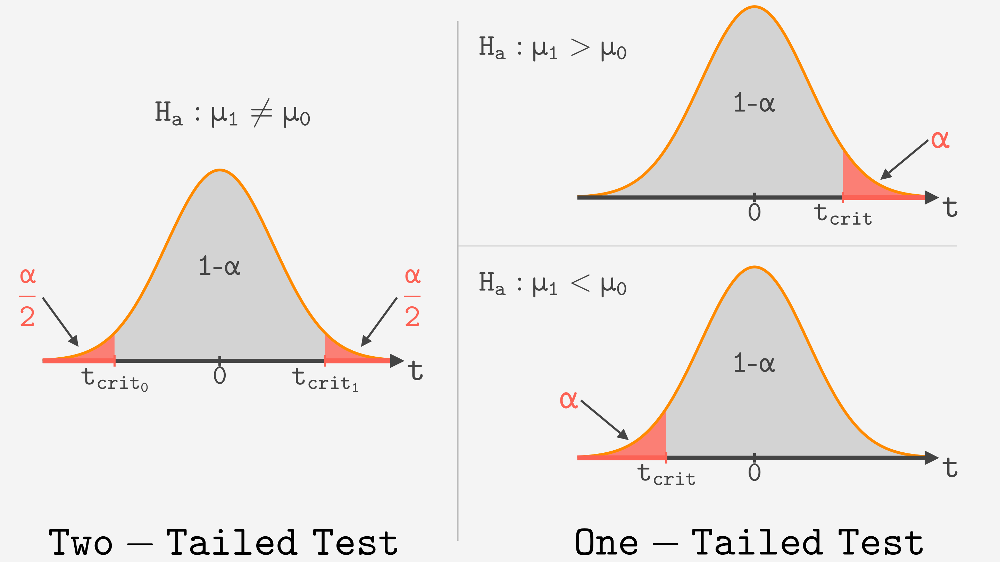

```{r setup, include=FALSE}
# Load useful packages
library(rmdformats)   # for extra formatting if needed
knitr::opts_chunk$set(echo = TRUE, warning = F, message = F, fig.retina = 5)
library(ggplot2)
```

```{=html}
<style>
body {
  font-size: 14px;   /* un poco más grande */
  color: black;      /* asegura texto en negro */
}

h1, h2, h3, h4, h5, h6 {
  color: #5dc1b9;        /* títulos en rojo */
  font-size: 16px
}

h3, h4, h5, h6 {
  color: black;        /* títulos en rojo */
}

h3 {
  font-size: 1em;   /* tamaño igual al texto normal */
}

/* para exportar a PDF: no partir fórmulas, tablas ni figuras entre páginas */
@media print {
  @page { size: A4; margin: 15mm 12mm; }
  * { -webkit-print-color-adjust: exact; print-color-adjust: exact; }
  h1, h2, h2 * { color: #5dc1b9 !important; }
  h1, h2, h3, h4 { break-after: avoid; }
  p:has(> strong:only-child), p:has(> em:only-child > strong) { break-after: avoid; }
  table, tr, img, .figure, p:has(img), mjx-container, .MathJax_Display, .math.display, li { break-inside: avoid; }
  a[href]:after { content: none !important; }
}

</style>
```

## **Estadística descriptiva**

**Media aritmética**

$$
\bar{x} = \mu = \frac{1}{n} \sum_{i=1}^{n} x_i
$$

donde:

-   $\bar{x} = \mu$ : media aritmética\
-   $n$ : número de muestras
-   $i$ : índice de los valores de la variable ($i = 1, 2, \dots, n$)\
-   $x_i$ : valor $i$-ésimo de la variable $x$

<br>

**Mediana**

-   Para un número **impar** de observaciones ($n$):

$$
\text{mediana}(x) = x_{\left(\frac{n+1}{2}\right)}
$$

-   Para un número **par** de observaciones:

$$
\text{mediana}(x) = \frac{x_{\left(\frac{n}{2}\right)} + x_{\left(\frac{n}{2}+1\right)}}{2}
$$

donde:

-   $\text{mediana}(x)$: mediana de los valores disponibles de la
    variable $x$\
-   $n$: número de observaciones disponibles para $x$
-   $x_{(i)}$: valor que ocupa la posición $i$ cuando los datos están ordenados de menor a mayor

<br>

**Moda**

$$
moda(x)=max_{k=1}(I_{i=1}(x_i=x_k))
$$

donde:

-   $\text{moda}(x)$: moda de los valores disponibles de la variable $x$
-   $\max_{k=1}()$: argumento que maximiza sobre $k$ en $1$ a $p$
-   $I_i()$: función indicadora que devuelve 1 si la condición interna
    es cierta para $i$ en $1$ a $n$

<br>

**Rango**

Diferencia entre el valor máximo y el mínimo de una variable $x$:

$$
rango = x_{\text{max}} - x_{\text{min}}
$$

<br>

**Varianza**

$$
s^2 = \frac{1}{n-1} \sum_{i=1}^{n} (x_i - \bar{x})^2
$$

donde:

-   $s^2$: varianza\
-   $n$: número de observaciones de la muestra\
-   $i$: índice de los valores de la variable ($i = 1, 2, \dots, n$)\
-   $x_i$: valor $i$-ésimo de la variable $x$\
-   $\bar{x}$: media aritmética

<br>

**Desviación estándar**

$$
SD = s = \sqrt{s^2}
$$

donde:

-   $SD = s$: desviación estándar\
-   $s^2$: varianza

<br>

**Cuantiles**

| Nombre | Símbolo | Porcentaje de los datos | Interpretación |
|:-----------------|:-----------------|:-----------------|:-----------------|
| Primer cuartil | $Q_1$ | 25% | El 25% de los datos son menores o iguales que este valor |
| Segundo cuartil (mediana) | $Q_2$ | 50% | El 50% de los datos son menores o iguales que este valor |
| Tercer cuartil | $Q_3$ | 75% | El 75% de los datos son menores o iguales que este valor |

<br>

**Rango intercuartílico**

$$
IQR=Q_3-Q_1
$$

<br>

***Outliers***

$$
\text{Cerca inferior} = Q_1 - 1.5 \times IQR
$$

$$
\text{Cerca superior} = Q_3 + 1.5 \times IQR
$$

<hr>

## **Distribuciones**

**Asimetría**

```{r,  eval=T, echo = F, fig.height=2.8,fig.width=8, fig.align="center", fig.retina=5}
library(ggplot2)
library(dplyr)
library(patchwork)

# Función para simplificar el tema de cada gráfico
clean_theme <- function() {
  theme_void() + 
    theme(
      plot.title = element_text(hjust = 0.5), # centrar títulos
      panel.border = element_rect(colour = "black", fill = NA, size = 0.8) # marco exterior
    )
}

# Sym
x_sym <- seq(-4, 4, length.out = 1000)
data_sym <- data.frame(x = x_sym, y = dnorm(x_sym, mean = 0, sd = 1))

p_norm <- ggplot(data_sym, aes(x, y)) +
  geom_area(fill = "#0E8A8A", alpha = 0.6) +
  labs(title = "Simétrica") +
  clean_theme()

# Asimetría positiva
x_pos <- seq(0, 10, length.out = 1000)
data_pos <- data.frame(x = x_pos, y = dgamma(x_pos, shape = 2, scale = 1))
p_pos <- ggplot(data_pos, aes(x, y)) +
  geom_col(fill = "#0E8A8A", alpha = 0.6) +
  labs(title = "Asimetría positiva") +
  clean_theme()

# Asimetría negativa
data_neg <- data.frame(x = -x_pos, y = dgamma(x_pos, shape = 2, scale = 1))
p_neg <- ggplot(data_neg, aes(x, y)) +
  geom_col(fill = "#0E8A8A", alpha = 0.6) +
  labs(title = "Asimetría negativa") +
  clean_theme()

# Organizar en cuadrícula 2x3
(p_pos | p_norm | p_neg)

```

<br>

**Curtosis**

```{r echo = F, fig.height=5, fig.width=8,fig.align='center'}
library(ggplot2)
library(dplyr)

# Crear secuencia de valores x
x <- seq(-5, 5, length.out = 1000)

# Distribución mesocúrtica (normal)
meso <- data.frame(
  x = x,
  y = dnorm(x, mean = 0, sd = 1),
  Tipo = "Mesocúrtica (normal)"
)

# Distribución leptocúrtica (colas cortas, más alta en el centro)
lepto <- data.frame(
  x = x,
  y = dnorm(x, mean = 0, sd = 0.5),
  Tipo = "Leptocúrtica (colas cortas)"
)

# Distribución platicúrtica (colas largas, más baja y ancha)
plati <- data.frame(
  x = x,
  y = dnorm(x, mean = 0, sd = 2),
  Tipo = "Platicúrtica (colas largas)"
)

# Unir los datos
df <- bind_rows(meso, lepto, plati)

# Graficar
ggplot(df, aes(x = x, y = y, color = Tipo)) +
  geom_line() +
  labs(x="",
       y = "Densidad") +
  theme_minimal() +
  scale_color_manual(values = c("cadetblue3", "orange2", "firebrick3")) +
  ggthemes::theme_base(base_size = 16) +
  theme(panel.grid=element_blank(),
        axis.text=element_text(color="black"),
        panel.background = element_rect(fill = "white"))
```

<hr>

## **Distribución binomial**

**Fórmula de la distribución binomial**

$$
P(X = k) = \binom{n}{k} p^k (1-p)^{n-k}
$$

donde:

-   $n$: número total de ensayos o repeticiones del experimento
-   $k$: número de éxitos observados
-   $p$: probabilidad de éxito en un solo ensayo
-   $1 - p$: probabilidad de fracaso

<br>

**Coeficiente binomial**

$$
{n \choose k} \;=\; \frac{n!}{k!\,(n - k)!}
$$

donde:

-   $n = 1, 2, \dots$: número total de ensayos
-   $k = 0, 1, 2, \dots , n$: número de éxitos posibles
-   Para cualquier número entero $m$,
    $m! = m \times (m - 1) \times (m - 2) \times \dots \times 1$

<br>

**Tabla resumen de la binomial**

| Símbolo      | Significado    | Expresión          |
|:-------------|:---------------|:-------------------|
| $P(X \le k)$ | “como mucho k” | $P(X \le k)$       |
| $P(X < k)$   | “menos de k”   | $P(X \le k-1)$     |
| $P(X \ge k)$ | “al menos k”   | $1 - P(X \le k-1)$ |
| $P(X > k)$   | “más de k”     | $1 - P(X \le k)$   |

<br>

Si la variable aleatoria sigue una distribución
$X \sim \text{Binomial}(n, p)$, entonces:

-   **Media**\
    $$
    \mu = n \times p
    $$

-   **Varianza**\
    $$
    \sigma^2 = n \times p \times (1 - p)
    $$

<hr>

## **Distribución normal**

Si la variable aleatoria sigue una distribución
$X \sim N(\mu, \sigma^2)$, entonces:

-   $\mu$ representa la **media**
-   $\sigma$ representa la **desviación estándar**

<br>

**Estandarización**

Si una variable aleatoria $X$ sigue una distribución normal con media
$\mu$ y varianza $\sigma^2$, $X \sim N(\mu,\ \sigma^2)$, entonces la
variable estandarizada:

$$
Z = \frac{X - \mu}{\sigma}
$$

sigue una distribución normal estándar: $Z \sim N(0,1)$.

Para pasar de un valor $Z$ a la escala original:

$$
X = \sigma Z + \mu
$$

<br>

**Probabilidades complementarias y simetría**

$$
P(Z \le z) = 1 - P(Z \ge z) \qquad\qquad P(Z \le -z) = P(Z \ge z)
$$

$$
P(a \le Z \le b) = P(Z \le b) - P(Z \le a) = P(Z \ge a) - P(Z \ge b)
$$

<br>

**Tabla resumen de la normal**

| Símbolo | Significado | Expresión |
|:-----------------------|:-----------------------|:-----------------------|
| $P(X \le x)$ | “como mucho x” | $P(X \le x)$ |
| $P(X < x)$ | “menos de x” | $P(X \le x)$ (igual, continua) |
| $P(X \ge x)$ | “al menos x” | $1 - P(X \le x)$ |
| $P(X > x)$ | “más de x” | $1 - P(X \le x)$ |
| $P(a \le X \le b)$ | “entre a y b” | $P(X \le b) - P(X \le a)$ |
| $P(a < X < b)$ | “entre a y b” | $P(X \le b) - P(X \le a)$ (igual, continua) |

<br>

**Regla empírica ("68-95-99.7")**:

```{r, echo = F, fig.align='center', fig.height=4.1, fig.width=5}
library(ggplot2)
library(dplyr)
library(ggthemes)

# Parámetros
mu <- 0
sigma <- 1

# Secuencia de valores para la curva
x <- seq(mu - 4*sigma, mu + 4*sigma, length.out = 1000)
df <- data.frame(x = x, y = dnorm(x, mean = mu, sd = sigma))

# Rellenos para cada rango
fill_areas <- list(
  data.frame(x = x[x >= mu - sigma & x <= mu + sigma],
             y = dnorm(x[x >= mu - sigma & x <= mu + sigma], mu, sigma),
             area = "±1σ"),
  data.frame(x = x[x >= mu - 2*sigma & x <= mu + 2*sigma],
             y = dnorm(x[x >= mu - 2*sigma & x <= mu + 2*sigma], mu, sigma),
             area = "±2σ"),
  data.frame(x = x[x >= mu - 3*sigma & x <= mu + 3*sigma],
             y = dnorm(x[x >= mu - 3*sigma & x <= mu + 3*sigma], mu, sigma),
             area = "±3σ")
) %>% bind_rows()

# Valores para las líneas verticales
sd_lines <- data.frame(
  x = c(mu - 3*sigma, mu - 2*sigma, mu - sigma, mu,
        mu + sigma, mu + 2*sigma, mu + 3*sigma),
  label = c("-3σ", "-2σ", "-1σ", "μ",
            "+1σ", "+2σ", "+3σ")
)

# Segmentos horizontales para porcentajes
segments <- data.frame(
  y = c(0.09, 0.05, 0),        # altura donde poner el segmento
  xstart = c(mu - sigma, mu - 2*sigma, mu - 3*sigma),
  xend   = c(mu + sigma, mu + 2*sigma, mu + 3*sigma),
  label  = c("68%", "95%", "99.7%")
)

# Gráfico
ggplot() +
  # Áreas rellenas (las más pequeñas encima de las grandes)
  geom_ribbon(data = filter(fill_areas, area == "±3σ"),
              aes(x = x, ymin = 0, ymax = y, fill = area), alpha = 0.3, show.legend = F) +
  geom_ribbon(data = filter(fill_areas, area == "±2σ"),
              aes(x = x, ymin = 0, ymax = y, fill = area), alpha = 0.4, show.legend = F) +
  geom_ribbon(data = filter(fill_areas, area == "±1σ"),
              aes(x = x, ymin = 0, ymax = y, fill = area), alpha = 0.6, show.legend = F) +
  # Curva
  geom_line(data = df, aes(x = x, y = y), size = 1, color = "white") +
  # Líneas verticales
  geom_vline(data = sd_lines, aes(xintercept = x),
             linetype = "dashed", color = "gray70") +
  # Segmentos horizontales
  geom_segment(
  data = segments,
  aes(x = xstart, xend = xend, y = y, yend = y),
  color = "black",
  linewidth = 1,
  arrow = arrow(ends = "both",    # flecha en ambos extremos <--->
                type = "closed",  # estilo "cerrado" para que sea triangular
                length = unit(0.05, "inches")) # tamaño de las puntas
) +
  geom_text(data = segments,
            aes(x = mu, y = y + 0.02, label = label),
            color = "black") +
  # Personalizar eje x
  scale_x_continuous(
    breaks = sd_lines$x,
    labels = sd_lines$label
  ) +
  scale_fill_manual(values = c("±1σ" = "orange2",
                               "±2σ" = "gold",
                               "±3σ" = "cadetblue3")) +
  labs(
    x = "Desviaciones estándar",
    y = "",
    fill = "Área"
  ) +
  ggthemes::theme_base(base_size = 18) +
  theme(panel.grid = element_blank(),
        axis.text = element_text(color = "black"),
        axis.text.y = element_blank(),
        axis.ticks.y = element_blank(),
        panel.background = element_rect(fill = "white"))


```

-   \~68% de los valores dentro de 1 desviación estándar de la media
-   \~95% dentro de 2 desviaciones estándar
-   \~99.7% dentro de 3 desviaciones estándar

<hr>

## **Distribución de Poisson**

**Fórmula de la distribución de Poisson**

$$
P(X = k) = \frac{ e^{-\lambda} \lambda^k}{k!}
$$

donde:

-   $X$: número de eventos en un intervalo dado\
-   $\lambda$: tasa esperada de eventos en ese intervalo ($n \times p$)
-   $k$: número de eventos observados

<br>

Si la variable aleatoria sigue una distribución de Poisson
$X \sim \text{Poisson}(\lambda)$, entonces:

-   $\lambda$ representa tanto la media como el parámetro de la
    distribución: $\mu = \lambda$

-   La desviación estándar es: $\sigma = \sqrt{\lambda}$

<br>

La probabilidad de exactamente $k$ eventos en $t$ unidades de tiempo es:

$$
P(X = k) = \frac{e^{-\lambda t} (\lambda t)^k }{k!}
$$

En $t$ unidades de tiempo, la media es $\mu = \lambda t$ y desviación
estándar $\sigma = \sqrt{\lambda t}$.

Si $\lambda$ es una tasa por individuo, el número esperado de eventos en
una población de $N$ individuos durante $t$ unidades de tiempo es:

$$
\mu = \lambda t N
$$

<br>

**Tabla resumen de la distribución de Poisson**

| Símbolo      | Significado    | Expresión          |
|:-------------|:---------------|:-------------------|
| $P(X \le k)$ | “como mucho k” | $P(X \le k)$       |
| $P(X < k)$   | “menos de k”   | $P(X \le k-1)$     |
| $P(X \ge k)$ | “al menos k”   | $1 - P(X \le k-1)$ |
| $P(X > k)$   | “más de k”     | $1 - P(X \le k)$   |

<br>

## **Tabla resumen de las distribuciones**

|   | Binomial | Normal | Poisson |
|:----------------:|:----------------:|:----------------:|:----------------:|
| Parámetros | $n$, $p$ | $μ$, $σ$ | $λ$ |
| Valores posibles | $0, 1, ..., n$ | $(-∞, ∞)$ | $0, 1, ..., ∞$ |
| Media | $np$ | $\mu$ | $\lambda$ |
| Desviación estándar | $\sqrt{np(1-p)}$ | $σ$ | $\sqrt{\lambda}$ ($\sqrt{\lambda t}$) |

<hr>

## **Intervalos de confianza**

**Distribución muestral de la media**

Si $X \sim N(\mu, \sigma^2)$, la media muestral sigue
$\bar{X} \sim N\left(\mu, \frac{\sigma^2}{n}\right)$, con:

$$
\mu_{\bar{X}} = \mu \qquad\qquad \sigma_{\bar{X}} = SE = \frac{\sigma}{\sqrt{n}}
$$

**Error estándar (SE)**: si solo tenemos la desviación estándar muestral,

$$
SE \approx \frac{s}{\sqrt{n}}
$$

<br>

**Estadístico z para una media muestral**

$$
z = \frac{\bar{x} - \mu}{\sigma / \sqrt{n}}
$$

donde:

-   $\bar{x}$: media muestral
-   $\mu$: media poblacional (bajo $H_0$, $\mu_0$)
-   $\sigma$: desviación estándar poblacional
-   $n$: tamaño de la muestra

<br>

**Intervalo de confianza (IC) bilateral**

$$
IC = (\bar{x} - m, \bar{x} + m) = \bar{x} \pm m
$$

donde $m$ es el **margen de error**:

$$
m = z_{\alpha/2} \times \frac{\sigma}{\sqrt{n}} \qquad \left(\text{o } m = z_{\alpha/2} \times \frac{s}{\sqrt{n}}\right)
$$

Por lo tanto, los límites del IC son:

$$
x_1 = \bar{x} - z_{\alpha/2} \frac{\sigma}{\sqrt{n}}, \quad
x_2 = \bar{x} + z_{\alpha/2} \frac{\sigma}{\sqrt{n}}
$$

<br>

**Intervalos de confianza unilaterales (*one-sided*)**

-   Proporcionan **un límite inferior o un límite superior**, pero **no
    ambos**. Todo el $\alpha$ va en una sola cola, por eso se usa
    $z_{\alpha}$ (y no $z_{\alpha/2}$):

$$
(-\infty,\ \bar{x} + z_{\alpha} \times SE) \quad \text{o} \quad (\bar{x} - z_{\alpha} \times SE,\ \infty)
$$

<br>

**Valores críticos de z**

| Nivel de confianza | $\alpha$ | **Bilateral:** $z_{\alpha/2}$ | **Unilateral:** $z_{\alpha}$ |
|:------------------:|:--------:|:-----------------------------:|:----------------------------:|
| 90% | 0.10 | 1.645 | 1.28 |
| 95% | 0.05 | 1.96 | 1.645 |
| 99% | 0.01 | 2.576 | 2.33 |

<br>

**Tamaño de muestra para un error máximo $E$**

$$
n \ge \left(\frac{z_{\alpha/2} \times \sigma}{E}\right)^2
$$

<hr>

## **Contraste de hipótesis**

**Tipos de error**

| Decisión | $H_0$ cierta | $H_A$ cierta |
|:--------------------|:---------------|:-----------------|
| **No rechazamos $H_0$** | Correcto ($1-\alpha$) | Error tipo II ($\beta$), falso negativo |
| **Rechazamos $H_0$** | Error tipo I ($\alpha$), falso positivo | Correcto ($1-\beta$) = **potencia** |

<br>

**Regla de decisión** (con el valor crítico del estadístico)

-   Si $|\text{estadístico}| \ge$ valor crítico (o p-valor $\le \alpha$) → **rechazamos $H_0$**
-   Si $|\text{estadístico}| <$ valor crítico (o p-valor $> \alpha$) → **no rechazamos $H_0$**

<br>

**p-valor de un test de permutación**

$$
\text{p-valor} = \frac{\#\{|\text{dif}_{perm}| \geq |\text{dif}_{obs}|\}}{n_{perm}}
$$

donde:

-   $\text{dif}_{obs}$: diferencia observada entre los grupos
-   $\text{dif}_{perm}$: diferencias obtenidas al permutar (barajar) las etiquetas de los grupos
-   $n_{perm}$: número de permutaciones

<hr>

## **T-test**

**Tablas resumen para t-test**

| Tipo de t-test | Estadístico t | Grados de libertad (df) | Intervalo de confianza (IC) |
|------------------|------------------|------------------|------------------|
| **1 muestra** | $t = \frac{\bar{x}-\mu_0}{s/\sqrt{n}}$ | $n-1$ | $\bar{x} \pm t_{\alpha/2,\,df} \frac{s}{\sqrt{n}}$ |
| **Pareado** | $t = \frac{\bar{x}_{dif}}{s_{dif}/\sqrt{n}}$ | $n-1$ | $\bar{x}_{dif} \pm t_{\alpha/2,\,df} \frac{s_{dif}}{\sqrt{n}}$ |
| **2 muestras independientes*** | $t = \frac{\bar{x}_1 - \bar{x}_2}{\sqrt{s^2_1/n_1 + s^2_2/n_2}}$ | Welch-Satterthwaite | $(\bar{x}_1 - \bar{x}_2) \pm t_{\alpha/2,\,df} \sqrt{s^2_1/n_1 + s^2_2/n_2}$ |

<small>*Fórmula de Welch (por defecto en `R`). Si asumimos varianzas iguales (t-test de Student), $df = n_1+n_2-2$ y se usa $s_p^2$ (ver abajo).</small>

<br>

| Tipo de t-test | Hipótesis nula ($H_0$) | Hipótesis alternativa ($H_A$) |
|------------------------|------------------------|------------------------|
| **1 muestra** | $\mu = \mu_0$ | $\mu \ne \mu_0$ |
| **Pareado** | $\mu_{dif} = 0$ | $\mu_{dif} \ne 0$ |
| **2 muestras independientes** | $\mu_1 = \mu_2$ | $\mu_1 \ne \mu_2$ |

<br>

| Tipo de test | Hipótesis | IC / Zona crítica | Interpretación |
|------------------|------------------|------------------|------------------|
| **Bilateral (dos colas)** | $H_0: \mu = \mu_0$ <br> $H_A: \mu \ne \mu_0$ | $IC = \bar{x} \pm |t_{crit}| \times SE$ | IC simétrico alrededor de $\bar{x}$. Si $\mu_0$ **no está dentro**, se rechaza $H_0$. |
| **Unilateral (cola derecha)** | $H_0: \mu = \mu_0$ <br> $H_A: \mu > \mu_0$ | $IC = (\bar{x} - |t_{crit}| \times SE, +\infty)$ | Si límite inferior \> $\mu_0$, se rechaza $H_0$. |
| **Unilateral (cola izquierda)** | $H_0: \mu = \mu_0$ <br> $H_A: \mu < \mu_0$ | $IC = (-\infty, \bar{x} + |t_{crit}| \times SE)$ | Si límite superior \< $\mu_0$, se rechaza $H_0$. |

<br>

<center></img></center>

<br>

**IC unilaterales con la distribución t** (una muestra, $df = n-1$)

$$
\text{Límite superior: } \mu \le \bar{x} + t_{\alpha,\,n-1}\times\frac{s}{\sqrt{n}} \qquad\qquad
\text{Límite inferior: } \mu \ge \bar{x} - t_{\alpha,\,n-1}\times\frac{s}{\sqrt{n}}
$$

**Decisión** (bilateral): si $|t| > t_{crit}$ → rechazamos $H_0$; si $|t| \le t_{crit}$ → no rechazamos $H_0$.

<br>

**t-test de 2 muestras independientes con varianzas iguales (Student)**

$$
t=\frac{\bar{x}_1 - \bar{x}_2}{\sqrt{s_p^2 \left( \frac{1}{n_1} + \frac{1}{n_2} \right)}} \qquad
s_p^2 = \frac{(n_1 - 1)s_1^2 + (n_2 - 1)s_2^2}{n_1 + n_2 - 2} \qquad
df = n_1 + n_2 - 2
$$

donde:

-   $s_p^2$: varianza combinada (*pooled*)

<br>

**t-test de Welch (varianzas desiguales): grados de libertad de Welch-Satterthwaite**

$$
df = \frac{\left( \frac{s_1^2}{n_1} + \frac{s_2^2}{n_2} \right)^2}
{\frac{\left( \frac{s_1^2}{n_1} \right)^2}{n_1 - 1} + \frac{\left( \frac{s_2^2}{n_2} \right)^2}{n_2 - 1}}
$$

<hr>

## **Tests no paramétricos**

**Test de Mann-Whitney (Wilcoxon de suma de rangos)**: alternativa al t-test de 2 muestras independientes

1.  Juntamos los valores de los dos grupos, los ordenamos y les asignamos un rango (1 al más pequeño; si hay empates, el rango medio).
2.  Sumamos los rangos de cada grupo ($R_1$ y $R_2$).

$$
U_1 = R_1 - \frac{n_1(n_1+1)}{2} \qquad
U_2 = R_2 - \frac{n_2(n_2+1)}{2} \qquad
U = \min(U_1, U_2)
$$

Comprobaciones: $U_1 + U_2 = n_1 \, n_2$ y $R_1 + R_2 = \frac{N(N+1)}{2}$, con $N = n_1 + n_2$.

<br>

**Aproximación normal de $U$**

$$
\mu_U = \frac{n_1 \, n_2}{2} \qquad
\sigma_U = \sqrt{\frac{n_1 \, n_2 \,(n_1+n_2+1)}{12}} \qquad
z = \frac{U - \mu_U}{\sigma_U}
$$

Si $|z| \ge z_{\alpha/2}$ (1.96 para $\alpha = 0.05$ bilateral) → rechazamos $H_0$.

<br>

**Test de Wilcoxon de rangos con signo**: alternativa al t-test pareado

1.  Calculamos la diferencia de cada par, $d_i = x_{2i} - x_{1i}$, y descartamos las diferencias iguales a 0.
2.  Ordenamos las diferencias en **valor absoluto** $|d_i|$ y les asignamos un rango.
3.  Sumamos los rangos de las diferencias positivas ($T^+$) y de las negativas ($T^-$).

$$
T^+ = \sum_{d_i > 0} \text{rango}(|d_i|) \qquad
T^- = \sum_{d_i < 0} \text{rango}(|d_i|) \qquad
W = \min(T^+, T^-)
$$

Comprobación: $T^+ + T^- = \frac{n(n+1)}{2}$ ($n$: número de pares con diferencia distinta de 0).

**Aproximación normal de $W$**

$$
\mu_W = \frac{n(n+1)}{4} \qquad
\sigma_W = \sqrt{\frac{n(n+1)(2n+1)}{24}} \qquad
z = \frac{W - \mu_W}{\sigma_W}
$$

<br>

| Diseño | Test paramétrico | Alternativa no paramétrica | *Post hoc* |
|:--------------------|:--------------------|:--------------------|:--------------------|
| 2 muestras independientes | t-test (Welch) | Mann-Whitney | — |
| 2 muestras pareadas | t-test pareado | Wilcoxon de rangos con signo | — |
| $\ge$ 3 grupos (1 factor) | ANOVA de una vía | Kruskal-Wallis | Dunn (con corrección de p-valores) |

<hr>

## **Tamaño del efecto y potencia**

**d de Cohen**

$$
d = \frac{\bar{x}_1-\bar{x}_2}{s_p} \qquad
s_p=\sqrt{\frac{(n_1-1)s^2_1+(n_2-1)s^2_2}{n_1+n_2-2}}
$$

donde:

-   $s_p$: desviación estándar combinada (*pooled*)

| $|d|$ | Efecto (guía orientativa de Cohen) |
|:--------------------|:--------------------|
| $< 0.2$ | trivial |
| $0.2 - 0.5$ | pequeño |
| $0.5 - 0.8$ | medio |
| $\ge 0.8$ | grande |

<br>

**Tamaño de muestra necesario (2 grupos)**

$$
n = \frac{2\,(Z_{\alpha/2} + Z_{\beta})^2}{d^2} \quad \text{por grupo}
$$

donde:

-   $Z_{\alpha/2}$: 1.96 para $\alpha = 0.05$ (bilateral); 2.58 para $\alpha = 0.01$
-   $Z_{\beta}$: 0.84 para potencia del 80%; 1.28 para potencia del 90%

<br>

**Potencia para un $n$ dado**

$$
Z_\beta = d\,\sqrt{\frac{n}{2}} - Z_{\alpha/2} \qquad\qquad \text{Potencia} = 1 - \beta = P(Z \le Z_\beta)
$$

<hr>

## **ANOVA**

#### ANOVA de una vía

| Fuente de variación | Suma de cuadrados (SS) | Grados de libertad (gl) | Media cuadrática (MS) | Estadístico F |
|:--------------------:|:----------------------:|:-----------------------:|:----------------------:|:--------------:|
| **Factor** (variabilidad entre grupos) | $SS_{entre} = \displaystyle \sum_{i=1}^{g} n_i (M_i - G)^2$ | $gl_{entre} = g - 1$ | $MS_{entre} = \dfrac{SS_{entre}}{gl_{entre}}$ | $F = \dfrac{MS_{entre}}{MS_{dentro}}$ |
| **Residuos** (variabilidad dentro de los grupos) | $SS_{dentro} = \displaystyle \sum_{i=1}^{g} \sum_{j=1}^{n_i} (x_{ij} - M_i)^2$ | $gl_{dentro} = N - g$ | $MS_{dentro} = \dfrac{SS_{dentro}}{gl_{dentro}}$ |  |
| **Total** | $SS_{total} = \displaystyle \sum_{i=1}^{g} \sum_{j=1}^{n_i} (x_{ij} - G)^2$ | $gl_{total} = N - 1$ |  |  |

**Donde:**

- $G$ = media global (media conjunta de todos los grupos)  
- $M_i$ = media del grupo *i*  
- $n_i$ = tamaño del grupo *i*  
- $g$ = número de grupos  
- $N$ = número total de observaciones
